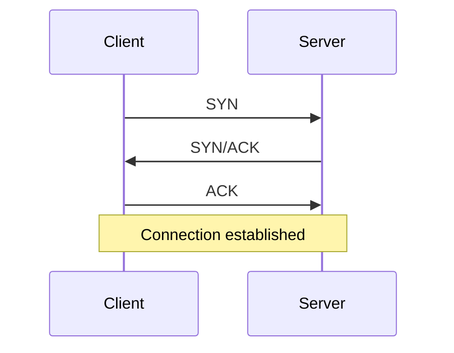
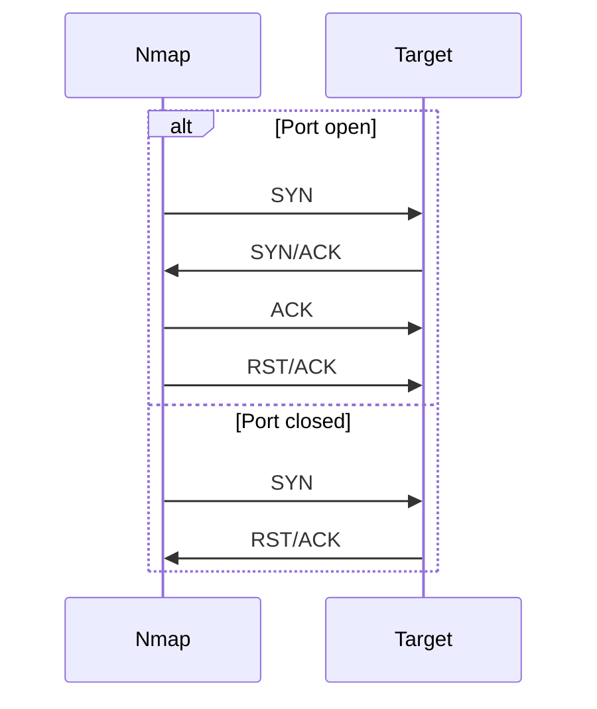
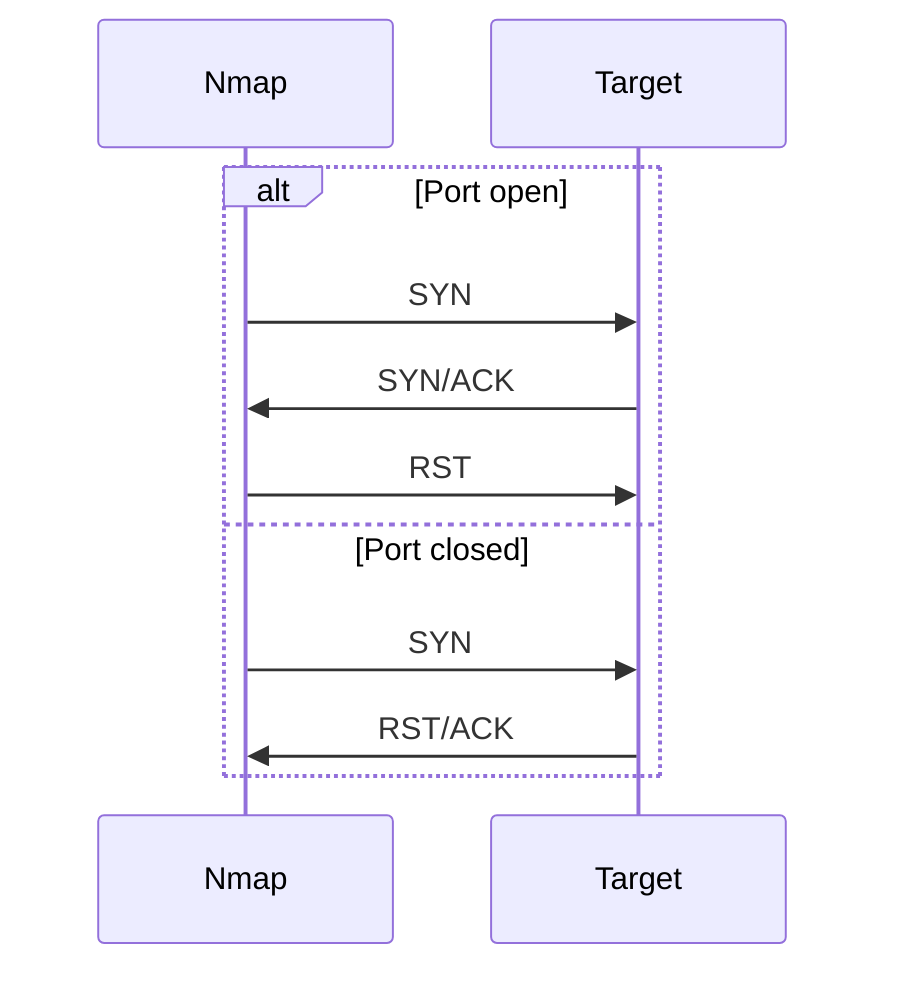
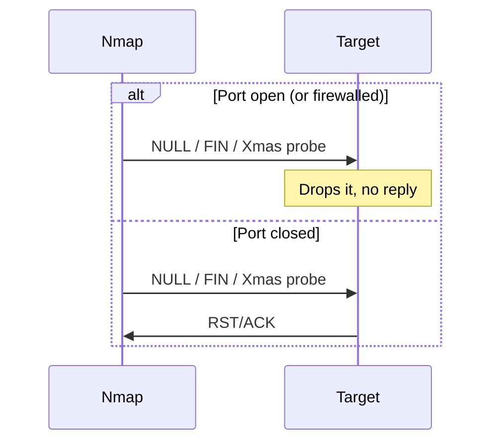
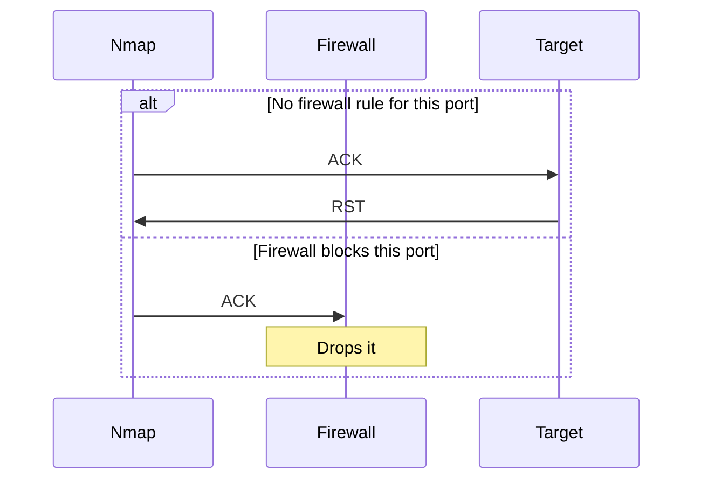

> [!summary] The big idea
> Nmap finds out whether a port is open by **choosing which TCP flags to set** in the packet it sends, then **reading which flags come back**.
> Each scan type is just a different flag combination.

---

## 1. The 6 TCP flags

Every TCP packet has 6 control bits that Nmap can **set (1)** or **unset (0)**. From left to right in the TCP header:

| Flag | Name | What it does | Plain English |
|---|---|---|---|
| **URG** | Urgent | The urgent pointer field is significant. The segment is processed immediately, without waiting for earlier segments. | "Handle this first!" |
| **ACK** | Acknowledgement | The acknowledgement number is significant. Used to confirm a segment was received. | "Got your message." |
| **PSH** | Push | Asks TCP to pass the data to the application promptly. | "Don't wait, deliver now." |
| **RST** | Reset | Resets (tears down) the connection. Also sent when there's no service on the port. Firewalls can send it too. | "Go away / nobody's here." |
| **SYN** | Synchronise | Starts the 3-way handshake and syncs sequence numbers (chosen randomly). | "Hi, want to talk?" |
| **FIN** | Finish | The sender has no more data to send. | "I'm done talking." |

---

## 2. A normal TCP 3-way handshake



---

## 3. The 4 rules Nmap takes advantage of

> [!important] How TCP stacks are supposed to behave (RFC 793)
> 1. **Open** port receives a SYN → replies **SYN/ACK**
> 2. **Closed** port receives almost anything (except RST) → replies **RST**
> 3. **Open** port receives a packet with **no SYN, RST, or ACK** → **silently drops it**
> 4. **Firewall** blocks the probe → **no reply**, or an **ICMP "destination unreachable"** error

Every scan in this note is just one of these rules in action.

---

## 4. The 6 Nmap port states

| State | Meaning | Typical clue |
|---|---|---|
| **Open** | A service is listening and accepting connections. | SYN/ACK reply |
| **Closed** | The port is reachable, but nothing is listening. Still proves the host is up and helps OS detection. | RST reply |
| **Filtered** | Nmap can't tell if it's open because something (usually a firewall) blocks the probe. | No reply, or ICMP unreachable (type 3, codes 1, 2, 3, 9, 10, 13) |
| **Unfiltered** | The port is reachable, but Nmap can't tell open from closed. **Only from the ACK scan.** | RST reply to an ACK probe |
| **Open\|Filtered** | Nmap can't tell open from filtered. | No reply to NULL, FIN, Xmas, Maimon, or UDP probes |
| **Closed\|Filtered** | Nmap can't tell closed from filtered. **Only from the idle scan.** | Zombie's IP ID didn't increase |

> [!tip] See Nmap's reasoning
> Add `--reason` to any scan to see which reply Nmap used to decide each port's state.

---

## 5. Which flags each scan sets

| Scan | Option | URG | ACK | PSH | RST | SYN | FIN |
|---|---|:-:|:-:|:-:|:-:|:-:|:-:|
| TCP Connect | `-sT` | | | | | ✅ | |
| TCP SYN (stealth) | `-sS` | | | | | ✅ | |
| NULL | `-sN` | | | | | | |
| FIN | `-sF` | | | | | | ✅ |
| Xmas | `-sX` | ✅ | | ✅ | | | ✅ |
| Maimon | `-sM` | | ✅ | | | | ✅ |
| ACK | `-sA` | | ✅ | | | | |
| Window | `-sW` | | ✅ | | | | |
| Custom | `--scanflags` | any | any | any | any | any | any |

> [!tip] Memory trick for Xmas
> **F**IN + **P**SH + **U**RG are all switched on, so the packet "lights up like a Christmas tree."

---

## 6. Each scan explained

### 6.1 TCP Connect scan (`-sT`)

- Completes the **full 3-way handshake** using the operating system's normal `connect()` call.
- Then tears the connection down with **RST/ACK**.
- ✅ Doesn't need root.
- ❌ Noisy: the target application can log the connection.



| Reply | State |
|---|---|
| SYN/ACK | **Open** |
| RST/ACK | **Closed** |
| Nothing / ICMP unreachable | **Filtered** |

---

### 6.2 TCP SYN scan (`-sS`): "stealth" or "half-open"

- Sends a SYN, but if the port answers SYN/ACK, Nmap sends **RST** instead of the final ACK.
- The connection is **never fully established**, so it's less likely to be logged by the application.
- Needs **root/sudo** (Nmap crafts raw packets).
- It's the **default scan** when Nmap runs with root privileges.



| Reply | State |
|---|---|
| SYN/ACK | **Open** |
| RST/ACK | **Closed** |
| Nothing / ICMP unreachable | **Filtered** |

---

### 6.3 NULL (`-sN`), FIN (`-sF`), and Xmas (`-sX`)

- None of these set SYN, RST, or ACK, so they rely on **rule 3**: open ports silently drop them.
- **NULL** = no flags at all. **FIN** = only FIN. **Xmas** = FIN + PSH + URG.



| Reply | State |
|---|---|
| RST/ACK | **Closed** |
| Nothing | **Open\|Filtered** |
| ICMP unreachable | **Filtered** |

> [!question] Why "open|filtered" and not just "open"?
> Silence could mean the port is open **or** that a firewall dropped the packet. Nmap can't tell which.

> [!note] Why use these scans?
> They can slip past simple **stateless firewalls** that only block incoming SYN packets.

> [!warning] Windows doesn't follow the rule
> Windows (and some other systems) reply **RST to everything**, so every port looks **closed** with these scans.

---

### 6.4 Maimon scan (`-sM`)

- Sends **FIN/ACK**.
- Old BSD systems dropped this packet on open ports, which revealed them.
- Most modern systems reply **RST whether the port is open or closed**, so this scan is rarely useful today.

---

### 6.5 ACK scan (`-sA`): firewall mapping

- Sends a lone **ACK**. Open and closed ports **both** reply RST.
- So it **can't tell open from closed**. Instead, it tells you whether a **firewall is filtering** the port.



| Reply | State |
|---|---|
| RST | **Unfiltered** |
| Nothing / ICMP unreachable | **Filtered** |

> [!important]
> The ACK scan answers **"Is a firewall in the way?"**, not **"Is the port open?"**

---

### 6.6 Window scan (`-sW`)

- Same ACK probe as the ACK scan, but Nmap also checks the **TCP window size** field in the returned RST.
- On some systems, a non-zero window means open and a zero window means closed.

| Reply | State |
|---|---|
| RST with **non-zero** window | **Open** |
| RST with **zero** window | **Closed** |
| Nothing / ICMP unreachable | **Filtered** |

> [!warning]
> This behaviour depends on the target's operating system, so results can be unreliable.

---

### 6.7 Custom scan (`--scanflags`)

- You choose the flags yourself, e.g. set all six:
  `sudo nmap --scanflags URGACKPSHRSTSYNFIN MACHINE_IP`
- You then interpret the replies based on how the target's TCP stack behaves.

---

### 6.8 Bonus: UDP (`-sU`) and Idle (`-sI`) scans

These don't use TCP flags the same way, but they produce two of the port states above.

| Scan | Reply | State |
|---|---|---|
| UDP `-sU` | UDP reply from the service | **Open** |
| | ICMP port unreachable (type 3, code 3) | **Closed** |
| | Other ICMP unreachable | **Filtered** |
| | No reply | **Open\|Filtered** |
| Idle `-sI` | Zombie's IP ID didn't increase | **Closed\|Filtered** |

---

## 7. Cheat sheet: reply → port state

| Scan | Reply from target | Port state |
|---|---|---|
| SYN `-sS` / Connect `-sT` | SYN/ACK | **Open** |
| | RST (RST/ACK) | **Closed** |
| | No reply or ICMP unreachable | **Filtered** |
| NULL `-sN` / FIN `-sF` / Xmas `-sX` / Maimon `-sM` | RST (RST/ACK) | **Closed** |
| | No reply | **Open\|Filtered** |
| | ICMP unreachable | **Filtered** |
| ACK `-sA` | RST | **Unfiltered** |
| | No reply or ICMP unreachable | **Filtered** |
| Window `-sW` | RST, non-zero window | **Open** |
| | RST, zero window | **Closed** |
| | No reply or ICMP unreachable | **Filtered** |
| UDP `-sU` | UDP reply | **Open** |
| | ICMP port unreachable | **Closed** |
| | Other ICMP unreachable | **Filtered** |
| | No reply | **Open\|Filtered** |
| Idle `-sI` | Zombie IP ID unchanged | **Closed\|Filtered** |

---

## 8. Command quick reference

```bash
nmap -sT MACHINE_IP                                 # TCP Connect scan (no root needed)
sudo nmap -sS MACHINE_IP                            # TCP SYN (stealth) scan
sudo nmap -sN MACHINE_IP                            # NULL scan (no flags)
sudo nmap -sF MACHINE_IP                            # FIN scan
sudo nmap -sX MACHINE_IP                            # Xmas scan (FIN, PSH, URG)
sudo nmap -sM MACHINE_IP                            # Maimon scan (FIN/ACK)
sudo nmap -sA MACHINE_IP                            # ACK scan (firewall mapping)
sudo nmap -sW MACHINE_IP                            # Window scan
sudo nmap --scanflags URGACKPSHRSTSYNFIN MACHINE_IP # Custom flags
sudo nmap -sU MACHINE_IP                            # UDP scan
sudo nmap -sI ZOMBIE_IP MACHINE_IP                  # Idle (zombie) scan
sudo nmap -sS --reason MACHINE_IP                   # Show why each state was chosen
```

---

## 9. Key takeaways

> [!success] Remember these
> - **SYN = "Hi?"**, **SYN/ACK = "Hi back" (open)**, **RST = "Go away" (closed)**, **silence = something's in the way (filtered)**.
> - Scans that **set SYN** (SYN, Connect) can **prove a port is open**.
> - Scans that **leave SYN off** (NULL, FIN, Xmas, Maimon) can only **prove a port is closed**, so a silent port is **open|filtered**.
> - The **ACK scan** maps **firewall rules**, not open ports → **unfiltered** vs **filtered**.
> - **RST is never part of the first probe** in these scans. Nmap only sends it to tear down a connection after a SYN/ACK; otherwise it's the "closed" signal coming back.

---

## Related notes

- [[1-Nmap – Host Keşfi|Nmap – Host Keşfi]]: finding live hosts before port scanning
- [[3-Common Network Protocols and Ports|Common Network Protocols and Ports]]: what the common open ports usually mean
