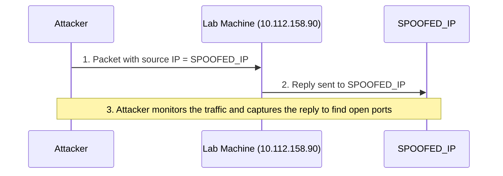
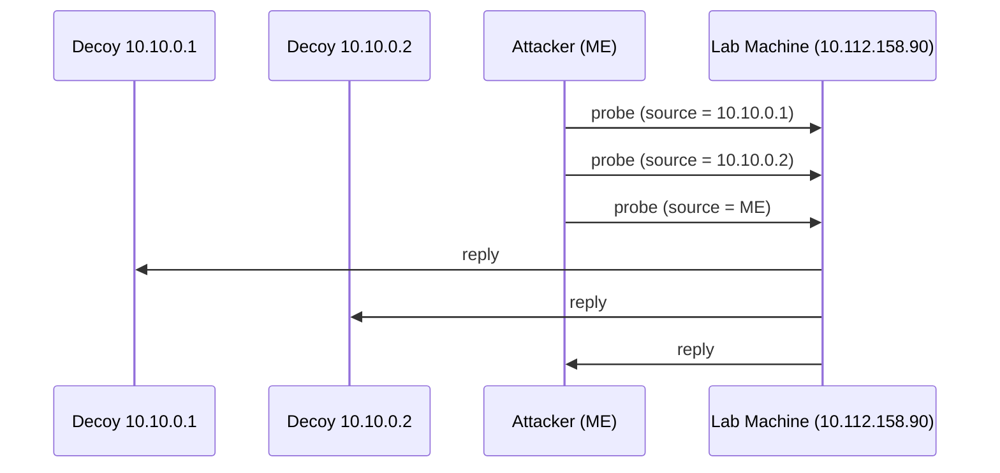

> [!summary] TL;DR
> - **IP spoofing (`-S`)**: Nmap puts a **fake source IP** on its packets. The target replies to that fake IP, **not to you**. So it only works if **you can capture those replies**.
> - **MAC spoofing (`--spoof-mac`)**: fake source MAC. Only works when you're on the **same subnet** (same Ethernet 802.3 or same WiFi 802.11).
> - **Decoys (`-D`)**: your real IP is **mixed in with many other IPs**, so it's hard to tell which one is the real scanner.

---

## 1. Scanning with a Spoofed IP Address

### What is it?
In some network setups, you can scan a target using a **spoofed (fake) IP address**, and even a **spoofed MAC address**.

### When is it useful?
> [!important] The golden rule
> Spoofing is **only beneficial when you can guarantee that you will capture the response**.

Why? Because the target sends its replies to the **spoofed IP**, not to you.
If you scan from some **random network** with a spoofed IP:
- the replies **won't be routed to you**
- your scan results will be **unreliable**

### How it works
The attacker runs:

```bash
nmap -S SPOOFED_IP 10.112.158.90
```

Nmap crafts **all** packets with `SPOOFED_IP` as the source address. The lab machine replies to `SPOOFED_IP`. To get accurate results, the attacker must **monitor network traffic** and analyse those replies.



### The 3 steps
1. The attacker **sends** a packet with a spoofed source IP address to the lab machine.
2. The lab machine **replies to the spoofed IP** address as the destination.
3. The attacker **captures the replies** to identify open ports.

### The full (correct) command
In practice, you should also specify the **network interface** and **disable the ping scan**:

```bash
nmap -e NET_INTERFACE -Pn -S SPOOFED_IP 10.112.158.90
```

| Option | Meaning | Why it's needed here |
|---|---|---|
| `-S SPOOFED_IP` | Use this as the source IP | This is the spoofing itself |
| `-e NET_INTERFACE` | Use this network interface | Tells Nmap **explicitly** which interface to send from |
| `-Pn` | Skip host discovery (no ping scan) | The ping reply would go to the spoofed IP, so Nmap should **not expect to receive a ping reply** |

> [!warning] Remember
> This scan is **useless** if the attacker's system **cannot monitor the network** for responses.

---

## 2. Spoofing the MAC Address

When you're on the **same subnet** as the lab machine, you can spoof your **MAC address** too:

```bash
nmap --spoof-mac SPOOFED_MAC 10.112.158.90
```

> [!info] Condition
> MAC spoofing is only possible if the attacker and the lab machine are on:
> - the same **Ethernet (802.3)** network, **or**
> - the same **WiFi (802.11)** network.
>
> (MAC addresses are only used inside the local network, so faking one only makes sense there.)

---

## 3. Decoy Scans

### Why decoys?
Spoofing only works in a **very small number of cases** where certain conditions are met. So the attacker may use **decoys** instead, to make it **harder to pinpoint** them.

### The idea
Make the scan **appear to come from many IP addresses**, so the attacker's real IP is **lost among them**.

In the example below, the scan appears to come from **3 different sources**, and the replies go to **the decoys as well** (and to the attacker).



From the target's point of view, three hosts are scanning it, and it can't easily tell which one is real.

### Syntax: `-D`
After `-D`, you list decoy IPs (specific or random), separated by commas.

| Keyword | Meaning |
|---|---|
| `10.10.0.1` (any IP) | A specific decoy address |
| `RND` | A **random** IP address |
| `ME` | **Your real IP**, placed at this position in the list |

### Example 1: specific decoys

```bash
nmap -D 10.10.0.1,10.10.0.2,ME 10.112.158.90
```

| Order | Source IP |
|---|---|
| 1st | `10.10.0.1` |
| 2nd | `10.10.0.2` |
| 3rd | `ME` → the attacker's real IP |

### Example 2: mixing in random decoys

```bash
nmap -D 10.10.0.1,10.10.0.2,RND,RND,ME 10.112.158.90
```

| Order | Source IP |
|---|---|
| 1st | `10.10.0.1` |
| 2nd | `10.10.0.2` |
| 3rd | `RND` → random IP |
| 4th | `RND` → random IP |
| 5th | `ME` → the attacker's real IP |

> [!tip] About `RND`
> Each time you run this command, you get **two new random IPs** as the 3rd and 4th decoy sources.

---

## Spoofing vs Decoys at a Glance

| | IP Spoofing (`-S`) | Decoys (`-D`) |
|---|---|---|
| Your real IP in the packets? | ❌ No, only the spoofed IP | ✅ Yes, hidden among the decoys |
| Who receives the replies? | The spoofed IP | All sources (decoys **and** you) |
| Must you capture traffic? | ✅ Yes, otherwise the scan is useless | ❌ No, your own replies come back to you |
| When does it work? | Only in a few specific setups | Much more often |
| Goal | Look like someone else | Hide in the crowd |

---

## Cheat Sheet

```bash
# Spoof source IP (basic)
nmap -S SPOOFED_IP 10.112.158.90

# Spoof source IP (proper way: set interface, skip ping)
nmap -e NET_INTERFACE -Pn -S SPOOFED_IP 10.112.158.90

# Spoof MAC address (same Ethernet / WiFi only)
nmap --spoof-mac SPOOFED_MAC 10.112.158.90

# Decoys: 2 fixed decoys, then your IP 3rd
nmap -D 10.10.0.1,10.10.0.2,ME 10.112.158.90

# Decoys: 2 fixed + 2 random, then your IP 5th
nmap -D 10.10.0.1,10.10.0.2,RND,RND,ME 10.112.158.90
```

---

## Self-Check

> [!question]- What do you add to `sudo nmap 10.112.158.90` to make the scan look like it's coming from `10.10.10.11` instead of your IP?
> `-S 10.10.10.11`

> [!question]- What do you add to `sudo nmap 10.112.158.90` to make the scan look like it's coming from `10.10.20.21` and `10.10.20.28` in addition to your IP?
> `-D 10.10.20.21,10.10.20.28,ME`

> [!question]- Why is a spoofed IP scan from a random network unreliable?
> Because the target sends its replies to the spoofed IP, so they are never routed back to you.

> [!question]- Why do we add `-Pn` to a spoofed scan?
> The ping reply would go to the spoofed IP, so Nmap shouldn't wait for a ping reply it will never receive.

> [!question]- When can you use `--spoof-mac`?
> Only when you and the target are on the same Ethernet (802.3) or the same WiFi (802.11) network.
