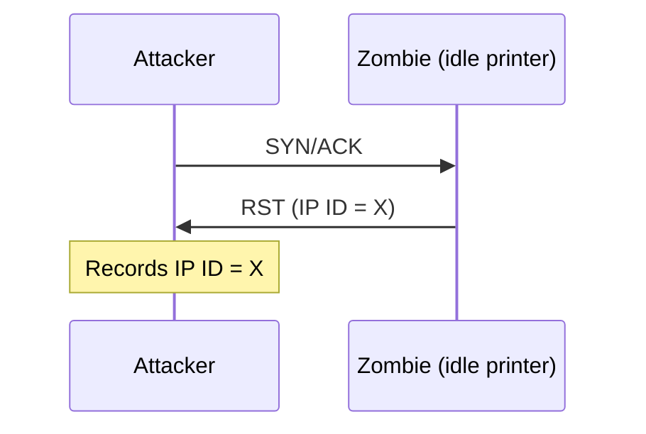
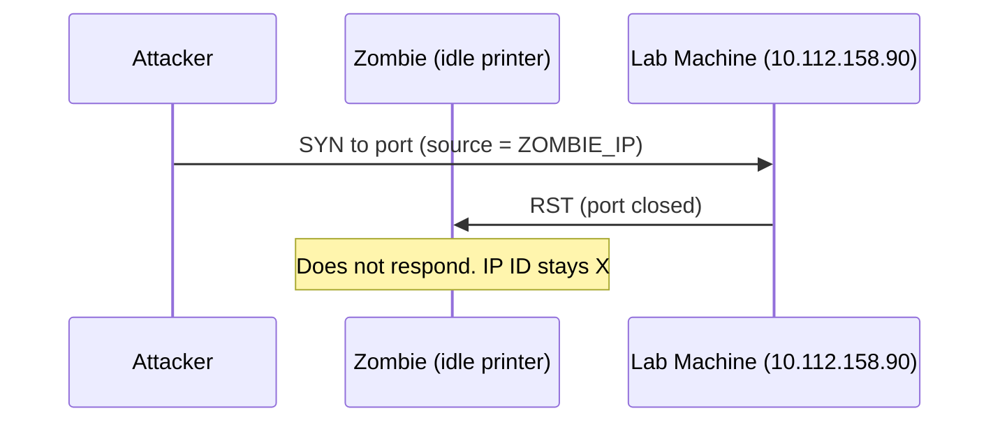
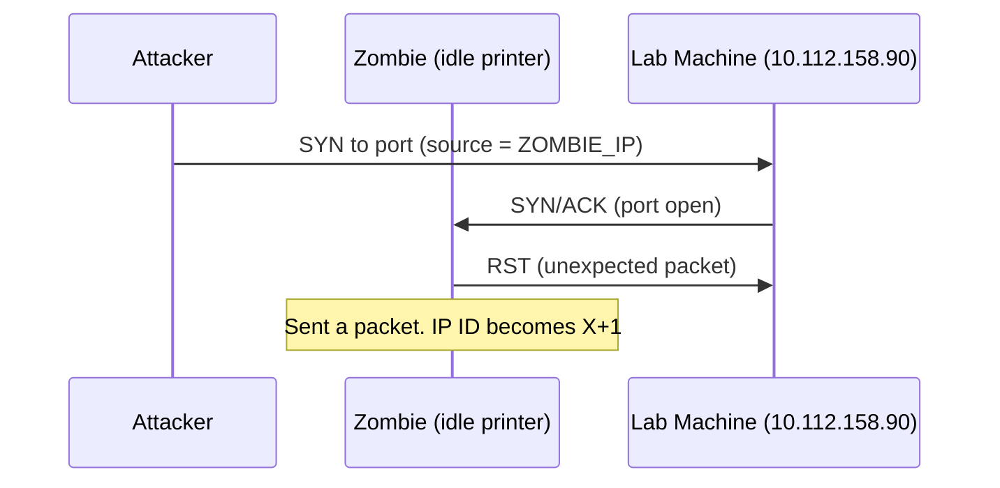
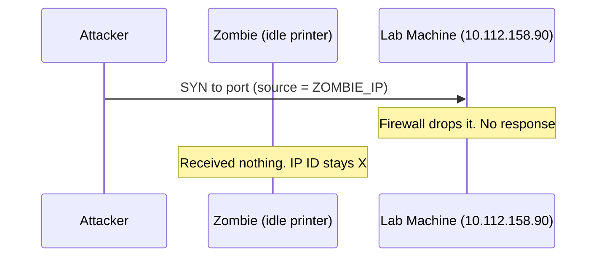
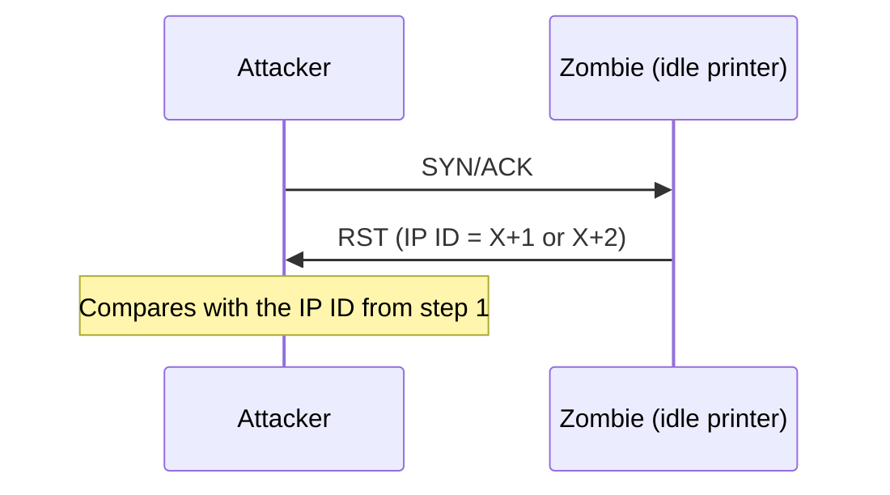

> [!summary] TL;DR
> - The idle scan is a **boosted version of IP spoofing**. Every probe appears to come from an **idle host (the zombie)**.
> - You find out whether the zombie got a reply by checking its **IP ID** value (a field in the IP header).
> - Command: `nmap -sI ZOMBIE_IP 10.112.158.90`
> - Compare the zombie's IP ID before and after: **difference 2 = open**, **difference 1 = closed or filtered**.
> - The zombie **must be idle**, otherwise the IP IDs are useless.

Related: [[3-Nmap - Spoofing and Decoys]]

---

## 1. Why the Idle Scan?

Spoofing the source IP can be an effective way to run **stealthy scans**, but it has limitations:
- it only works in **specific network setups**
- you must be in a position to **monitor traffic**

So plain IP spoofing is **unlikely to be useful**. The **idle scan** gives it a boost.

> [!info] The key difference
> With plain spoofing, you have to **capture the target's replies** yourself.
> With the idle scan, you don't. You just **ask the zombie** and read the answer from its **IP ID**.

---

## 2. What You Need

An **idle system** connected to the network that **you can communicate with**. This is the **zombie**.

In the TryHackMe example, the zombie is a **multi-function printer** (a device that sits on the network and rarely sends traffic).

### The core idea
1. Nmap makes each probe **appear to come from the zombie**.
2. Then it checks whether the **zombie received any response** to that spoofed probe.
3. It does this by checking the **IP identification (IP ID)** value in the IP header.

> [!note] What is the IP ID?
> A field in the IP header. Think of it as a **counter**: each time the zombie sends a packet, the IP ID goes **up by one**.
> So if you read the counter, then read it again later, you know **how many packets the zombie sent in between**.

### The command

```bash
nmap -sI ZOMBIE_IP 10.112.158.90
```

| Part | Meaning |
|---|---|
| `-sI` | Idle (zombie) scan |
| `ZOMBIE_IP` | IP address of the idle host (zombie) |
| `10.112.158.90` | The target (lab machine) |

---

## 3. The 3 Steps

1. **Trigger** the idle host to respond, so you can **record its current IP ID**.
2. Send a **SYN** packet to a TCP port on the target, **spoofed** to appear to come from the **zombie's IP**.
3. **Trigger** the idle host again, and **compare the new IP ID** with the one you recorded earlier.

Below, `X` is the IP ID the zombie returns in step 1.

---

### Step 1: Record the zombie's IP ID

The attacker sends a **SYN/ACK** to the idle machine (the printer).
The printer never started a connection, so it answers with an **RST**, which carries its **newly incremented IP ID**.



---

### Step 2: Send a spoofed SYN to the target

The attacker sends a **SYN** to the TCP port they want to check on the lab machine, but with the **zombie's IP as the source**.
So the lab machine will reply **to the zombie**, not to the attacker.

Three scenarios can happen:

#### Scenario 1: Port is **closed**
The lab machine replies to the zombie with an **RST**.
The zombie **does not respond** to it, so its IP ID is **not incremented**.



#### Scenario 2: Port is **open**
The lab machine replies to the zombie with a **SYN/ACK**.
The zombie didn't expect it, so it replies with an **RST**, which **increments its IP ID**.



#### Scenario 3: Port is **filtered** (firewall)
The lab machine **does not respond at all** because of firewall rules.
Same outcome as a closed port: the zombie **does not increment** its IP ID.



---

### Step 3: Read the zombie's IP ID again

The attacker sends **another SYN/ACK** to the zombie.
The zombie answers with an **RST**, incrementing its IP ID **by one again**.



The attacker compares the IP ID of the RST from **step 1** with the IP ID of the RST from **step 3**.

---

## 4. Reading the Result

| Port state | Zombie packets sent in step 2 | IP ID in step 1 | IP ID in step 3 | Difference | Conclusion |
|---|---|---|---|---|---|
| Closed | 0 | X | X+1 | **1** | Closed or filtered |
| Filtered | 0 | X | X+1 | **1** | Closed or filtered |
| Open | 1 (the RST) | X | X+2 | **2** | **Open** |

> [!tip] Easy way to remember
> The step 3 RST always adds **+1**.
> If there's an **extra +1**, the zombie must have sent an RST to the target, which only happens when the target sent it a SYN/ACK, so the port is **open**.
> - **Difference 2** → open
> - **Difference 1** → closed **or** filtered (the idle scan can't tell these two apart)

---

## 5. Why It Must Be *Idle*

This scan is called an **idle scan** because choosing an **idle host is essential to its accuracy**.

> [!warning] Busy zombie = useless results
> If the "idle host" is **busy**, it sends its own packets too, and each one increases the IP ID.
> Then you can't tell which increments came from your scan, so **all the returned IP IDs are useless**.

---

## Cheat Sheet

```bash
# Idle (zombie) scan
nmap -sI ZOMBIE_IP 10.112.158.90
```

| Step | Attacker sends | Zombie replies | Purpose |
|---|---|---|---|
| 1 | SYN/ACK → zombie | RST (IP ID = X) | Record starting IP ID |
| 2 | SYN → target, source = zombie | (RST to target **only if** port open) | Make the target talk to the zombie |
| 3 | SYN/ACK → zombie | RST (IP ID = X+1 or X+2) | Compare with step 1 |

---

## Self-Check

> [!question]- You found a rarely used network printer at `10.10.5.5` and want to use it as a zombie. What argument do you add to your Nmap command?
> `-sI 10.10.5.5`

> [!question]- What does the attacker send to the zombie in steps 1 and 3, and what does the zombie reply with?
> The attacker sends a **SYN/ACK**. The zombie replies with an **RST** containing its incremented IP ID.

> [!question]- The IP ID difference between step 1 and step 3 is 2. What is the port state?
> **Open**. The target sent a SYN/ACK to the zombie, and the zombie answered with an RST, which added the extra increment.

> [!question]- The difference is 1. What is the port state?
> **Closed or filtered**. The zombie sent no packet in step 2, so only the step 3 RST increased the IP ID.

> [!question]- Why does the zombie not increment its IP ID when the port is closed?
> The target sends the zombie an RST, and the zombie **does not respond** to it, so it sends no packet.

> [!question]- Why must the zombie be idle?
> A busy host sends its own packets, which also increase the IP ID, making the IP IDs useless for the scan.
