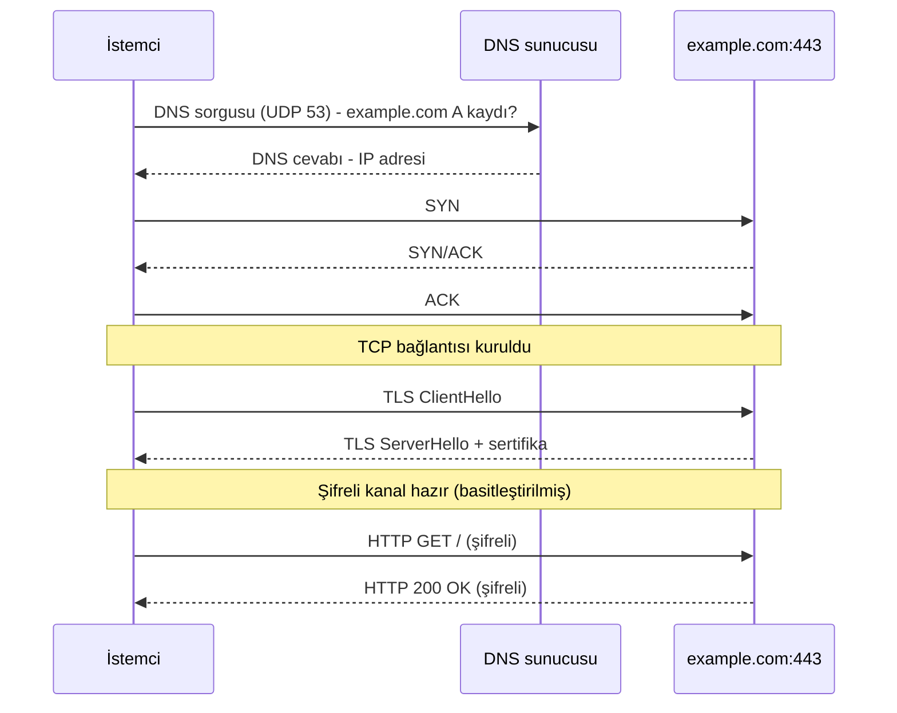

> [!summary] Özet
> TCP/IP modeli, internetin **gerçekte kullandığı** 4 katmanlı modeldir. ABD Savunma Bakanlığı'nın ARPANET projesinden doğdu, katmanları RFC 1122'de (1989) tanımlandı.
> [[0-OSI Modeli|OSI]] önce model olarak tasarlanıp protokolleri sonradan aranan bir referanstır. TCP/IP'de ise önce protokoller yazıldı, model onları anlatmak için çıktı.

## 4 Katman ve OSI Karşılığı

| TCP/IP katmanı | OSI karşılığı | Görevi | Protokoller | Veri birimi |
|---|---|---|---|---|
| **Uygulama** (Application) | 7, 6, 5 | Uygulamaya özel iletişim; biçim ve oturum da burada | HTTP, DNS, SSH, FTP, SMTP, DHCP, TLS | Veri / mesaj |
| **Taşıma** (Transport) | 4 | Uçtan uca iletim, port ile doğru uygulamaya teslim | TCP, UDP | Segment / datagram |
| **İnternet** (Internet) | 3 | IP adresleme ve ağlar arası yönlendirme | IPv4, IPv6, ICMP, IPsec | Paket |
| **Bağlantı** (Link / Network Access) | 2, 1 | Yerel ağda iletim ve fiziksel aktarım | Ethernet, Wi-Fi, ARP, PPP | Çerçeve |

> [!note] 4 mü, 5 mi?
> Bazı kaynaklar (ör. Kurose & Ross, Tanenbaum) Bağlantı katmanını **Fiziksel** ve **Veri Bağlantısı** diye ikiye ayırıp **5 katmanlı** bir model kullanır. Katman adları da değişebilir: Link = Network Access = Network Interface. Mantık aynıdır.

## Bir İsteğin Yolculuğu: `https://example.com`

0. **Bağlantı (ARP):** DNS sunucusu ve web sunucusu başka ağda olduğu için paketler gateway'e gider. Gateway'in MAC adresi bilinmiyorsa önce ARP ile sorulur.
1. **Uygulama (DNS, UDP 53):** `example.com`'un IP adresi sorulur.
2. **Taşıma (TCP 443):** Üçlü el sıkışma ile bağlantı kurulur: SYN → SYN/ACK → ACK.
3. **Uygulama (TLS):** Şifreleme anahtarları belirlenir, sunucu sertifikasını gönderir.
4. **Uygulama (HTTP):** `GET /` isteği şifreli kanaldan gider, cevap aynı yoldan döner.



> [!important] Yol üzerindeki her router'da
> Bağlantı katmanı başlığı (MAC adresleri) yeniden yazılır ve IP başlığındaki TTL 1 azalır. IP adresleri, TCP portları ve veri değişmez (NAT yoksa).

## Kapsülleme: Gerçek Başlıklar

```
[Ethernet][  IPv4  ][  TCP   ][   Veri (TLS, HTTP...)   ][FCS]
  14 B     20–60 B   20–60 B                              4 B
          |<------------ Paket (İnternet) ------------->|
                    |<------- Segment (Taşıma) -------->|
|<------------------- Çerçeve (Bağlantı) ------------------->|
```

| Başlık | Boyut | Güvenlik açısından önemli alanlar |
|---|---|---|
| Ethernet II | 14 bayt + 4 bayt FCS | Hedef/kaynak MAC, EtherType (`0x0800` IPv4, `0x0806` ARP, `0x86DD` IPv6) |
| IPv4 | 20–60 bayt | Kaynak/hedef IP, TTL, Protocol (`1` ICMP, `6` TCP, `17` UDP), IP ID, parçalama (fragment) bayrakları |
| TCP | 20–60 bayt | Kaynak/hedef port, sıra (seq) ve onay (ack) numaraları, bayraklar (SYN, ACK, RST, FIN...), pencere (window) |
| UDP | 8 bayt | Kaynak/hedef port, uzunluk, checksum |

- Ethernet'te tipik MTU **1500 bayttır**. Bir TCP segmentine sığan veri (MSS) = 1500 − 20 (IP) − 20 (TCP) = **1460 bayt**.

> [!info] Bu alanlar keşif ve saldırıda nerede karşına çıkar?
> - **Kaynak IP** doğrulanmaz → IP spoofing mümkündür (Nmap'in decoy taraması `-D`, Smurf saldırısı).
> - **TTL:** Ping cevabındaki TTL işletim sistemi hakkında ipucu verir. Linux genelde `64`, Windows `128`, ağ cihazları `255` ile başlar. Her router 1 azalttığı için gelen değerin üstündeki en yakın başlangıç değerine bak (`63` → büyük ihtimalle Linux). traceroute da bu alanı kullanır.
> - **IP ID:** Nmap idle (zombie) taraması bu alanın artışını izler.
> - **TCP bayrakları:** Nmap'in port tarama türleri farklı bayrak kombinasyonlarıdır.
> - **Window:** Nmap window taraması (`-sW`) bu alana bakar.
> - **Parçalama:** Paketleri küçük parçalara bölmek (`nmap -f`) basit paket filtrelerini atlatmak için kullanılabilir.

## TCP ve UDP

| | TCP | UDP |
|---|---|---|
| Bağlantı | Bağlantı yönelimli (üçlü el sıkışma) | Bağlantısız |
| Güvenilirlik | Sıralama, onay (ACK), kayıpta yeniden gönderim | Garanti yok |
| Akış ve tıkanıklık kontrolü | Var | Yok |
| Başlık | 20+ bayt | 8 bayt |
| Hız | Ek yük fazla, daha yavaş | Ek yük az, hızlı |
| Örnekler | HTTP(S), SSH, FTP, SMTP | DNS, DHCP, SNMP, VoIP, oyunlar, HTTP/3 (QUIC) |
| Taramada | Kapalı port RST döner, sonuç net | Açık port çoğu zaman sessizdir → `open\|filtered`, tarama yavaştır |

- DNS normalde UDP 53 kullanır. Büyük cevaplarda ve zone transfer'da (AXFR) TCP 53'e geçer.
- HTTP/3, UDP üzerinde çalışan QUIC protokolünü kullanır. Yani "web = TCP" her zaman doğru değil.
- El sıkışma ve bayrakların ayrıntısı: [[2-Nmap Scans and TCP Flags|Nmap Scans and TCP Flags]]

## Portlar

| Aralık | Adı | Örnek |
|---|---|---|
| 0–1023 | Sistem / iyi bilinen (well-known) | 22 SSH, 53 DNS, 80 HTTP, 443 HTTPS |
| 1024–49151 | Kayıtlı (registered) | 3306 MySQL, 3389 RDP, 8080 alternatif HTTP |
| 49152–65535 | Dinamik / geçici (ephemeral) | İstemcinin bağlantı için seçtiği kaynak port |

- Linux'ta 1024'ün altındaki portları dinlemek için root yetkisi gerekir.
- Linux'un varsayılan geçici port aralığı `32768–60999`'dur: `cat /proc/sys/net/ipv4/ip_local_port_range`
- Bir bağlantıyı benzersiz kılan **5'li (5-tuple):** protokol + kaynak IP + kaynak port + hedef IP + hedef port.

## OSI ve TCP/IP Karşılaştırması

| | OSI | TCP/IP |
|---|---|---|
| Katman sayısı | 7 | 4 (bazı kaynaklarda 5) |
| Ortaya çıkışı | ISO, 1984 | ARPANET, 1970'ler (katmanlar RFC 1122, 1989) |
| Yaklaşım | Önce model, sonra protokol | Önce protokol, sonra model |
| Kullanım alanı | Öğretim, sorun giderme, ortak terminoloji | İnternetin gerçek protokol yığını |
| Oturum ve sunum | Ayrı katmanlar | Uygulama katmanının içinde |

> [!warning] TCP/IP güvenlik düşünülmeden tasarlandı
> IP kaynak adresini, ARP ise cevabın kimden geldiğini doğrulamaz. Güvenlik katmanlara sonradan eklendi:
> - **Bağlantı:** WPA2/WPA3, 802.1X
> - **İnternet:** IPsec
> - **Taşıma ile Uygulama arası:** TLS
> - **Uygulama:** DNSSEC, SSH

## Hızlı Komutlar

```bash
ip a                              # arayüzler, IP ve MAC adresleri (Bağlantı + İnternet)
ip route                          # yönlendirme tablosu ve default gateway (İnternet)
ip neigh                          # ARP tablosu: IP ↔ MAC eşleşmeleri (Bağlantı)
ss -tulnp                         # dinleyen TCP/UDP portları ve süreçleri (Taşıma)
sudo tcpdump -i eth0 -n port 53   # DNS trafiğini yakala (Uygulama)
```

## İlgili Notlar

- [[0-OSI Modeli|OSI Modeli]]: 7 katman, katmanlara göre saldırılar ve savunmalar
- [[2-Nmap Scans and TCP Flags|Nmap Scans and TCP Flags]]: TCP bayrakları, el sıkışma ve port durumları
- [[2-ping & traceroute|ping & traceroute]]: ICMP ve TTL'in pratikte kullanımı
- [[2-nslookup & dig|nslookup & dig]]: DNS sorguları
- [[3-Common Network Protocols and Ports|Common Network Protocols and Ports]]: yaygın protokoller ve portlar
- [[1-CIDR Gösterimi|CIDR Gösterimi]]: IP adreslerinin ağ ve host kısmı
