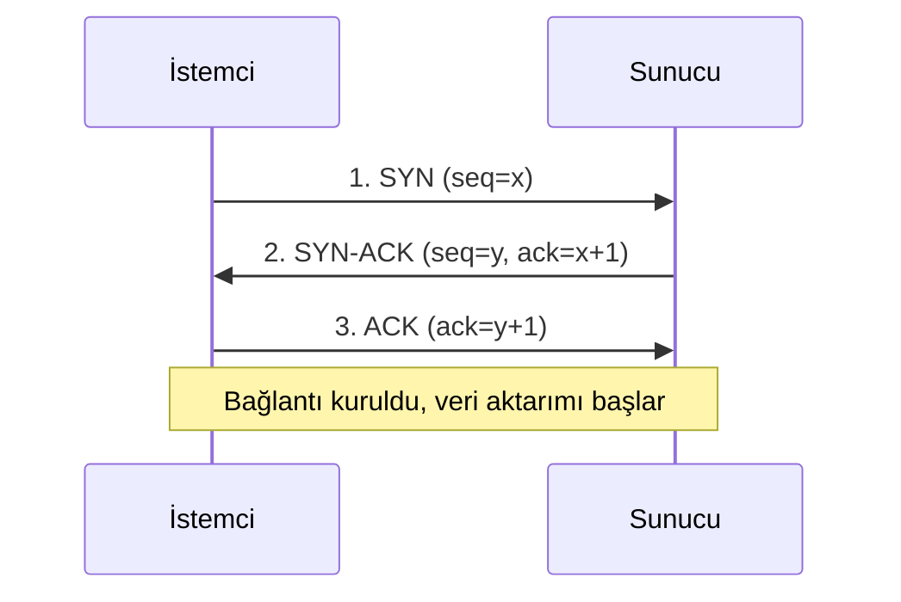

> [!summary] Özet
> **TCP (Transmission Control Protocol)**, iki cihaz arasında **güvenilir, bağlantı yönelimli** iletişim sağlayan taşıma katmanı protokolüdür. Veriyi sıra numaralı segmentlere böler, hatalı/eksik paketleri yeniden gönderir ve doğru sırada birleştirir. Bağlantı, **üçlü el sıkışma (three-way handshake)** ile kurulur.

## TCP Segment Formatı

Bir TCP paketi **header (başlık)** ve **data (veri)** olmak üzere iki bölümden oluşur. Başlık en az **20 bayttır**:

| Alan | Açıklama |
|---|---|
| **Source Port** | Gönderen cihazın hangi uygulamasının veri yolladığını belirten port |
| **Destination Port** | Hedefteki alıcı uygulamanın portu (ör. HTTP 80, HTTPS 443) |
| **Sequence Number** | Segmentin akıştaki sırası; verinin doğru sırada birleştirilmesini sağlar |
| **Acknowledgment Number** | Alınan segmentin sıra numarasını onaylar |
| **Header Length** | Başlık uzunluğu (20–60 bayt) |
| **Flags** | Bağlantı kontrol sinyalleri: SYN, ACK, FIN, RST, PSH, URG |
| **Window Size** | Alıcının kabul edebileceği veri miktarı; akış kontrolüne yardımcı olur |
| **Checksum** | Paketin hata kontrolü |
| **Urgent Pointer** | Acil verinin varlığını ve konumunu belirtir |

**Data:** Başlıktan sonra gelen, uygulama katmanından gelen asıl veri. Boyutu ağın MTU değerine ve başlık uzunluğuna göre değişir.

> [!note] Neden güvenilir?
> Hatalı veya eksik paketleri algılayıp yeniden ilettiği, sıra numaralarıyla veriyi doğru sırada birleştirdiği için güvenilirdir. Bu güvence, el sıkışma ve onay (ACK) mekanizmasının ek yük getirmesi pahasına gelir.

## TCP Three-Way Handshake

İki cihaz arasında güvenilir bir bağlantı kurma sürecidir, üç adımdan oluşur:

1. **SYN** — İstemci, başlangıç sıra numarasını (sequence number) taşıyan bir SYN paketiyle bağlantı isteği gönderir.
2. **SYN-ACK** — Sunucu isteği kabul ederse, kendi sıra numarasını ve istemcininkini onaylayan (`x+1`) bir SYN-ACK gönderir.
3. **ACK** — İstemci, sunucunun sıra numarasını onaylayan (`y+1`) bir ACK gönderir. Bağlantı kurulmuştur.

## İlgili Notlar

- [[13-UDP|UDP]]: hızlı ama güvenilir olmayan alternatif
- [[4-TCP-IP Modeli|TCP/IP Modeli]]: taşıma katmanı ve başlık alanları
- [[2-Nmap Scans and TCP Flags|Nmap Scans and TCP Flags]]: SYN/ACK/RST bayraklarıyla port tarama
