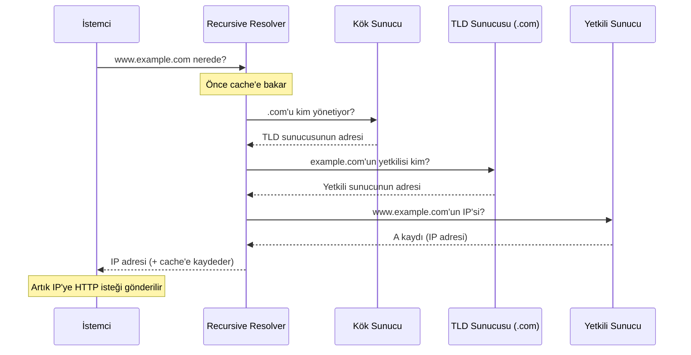

> [!summary] Özet
> **DNS (Domain Name System)**, internetin "telefon rehberidir": insan tarafından okunabilen alan adlarını (`www.example.com`) bilgisayarların kullandığı sayısal IP adreslerine (`192.0.2.1`) çevirir. Dağıtık ve hiyerarşik bir sistemdir; çözümleme kök → TLD → yetkili sunucu zinciriyle yapılır. Pratikte sorgulamak için bkz. [[2-nslookup & dig|nslookup & dig]].

## Kısa Tarihçe

- İlk günlerde (ARPANET) ana bilgisayar adları, merkezi tek bir **`hosts.txt`** dosyasıyla IP'lere eşlenirdi. İnternet büyüdükçe bu yöntem yönetilemez hale geldi.
- **1983**'te Paul Mockapetris ve Jon Postel, **RFC 882/883** ile DNS'i tanıttı: dağıtık, hiyerarşik ve ölçeklenebilir bir çözümleme sistemi.

## Alan Adı (Domain) Yapısı

Alan adları noktalarla ayrılmış, sağdan sola yükselen bir hiyerarşidir. Örnek `www.example.com`:

| Parça | Adı | Açıklama |
|---|---|---|
| **www** | Subdomain (alt alan adı) | Bir alanın altındaki ayrı bir bölüm/host |
| **example** | Second-Level Domain | Kaydedilen asıl isim |
| **com** | Top-Level Domain (TLD) | En üst seviye uzantı |

### TLD Türleri

- **gTLD** (genel): `.com` (ticari), `.org` (kâr amacı gütmeyen), `.net`, ve yeni nesil `.tech`, `.guru`, `.photography` gibi.
- **Özel ayrılmış:** `.gov` (devlet), `.edu` (eğitim) — kayıt kısıtlıdır.
- **ccTLD** (ülke kodu): `.uk` (Birleşik Krallık), `.de` (Almanya), `.tr` (Türkiye).

## DNS Sunucu Türleri

Bir sorgu çözülürken üç ana oyuncu vardır:

| Sunucu | Rolü |
|---|---|
| **Recursive Resolver** (Özyineli Çözücü) | Kullanıcı adına tüm araştırmayı yapan "aracı". Genelde ISP'nin sunucusudur. Sonuçları **önbelleğe (cache)** alır. |
| **Root Name Server** (Kök Ad Sunucusu) | Hiyerarşinin tepesi. Hangi TLD sunucusuna gidileceğini söyler. |
| **Authoritative Name Server** (Yetkili Ad Sunucusu) | Bir alan adının **resmi** kayıt kaynağı; A, MX, CNAME gibi kayıtları burada tutulur. Kesin cevap buradan gelir. |

## Çözümleme Süreci (Resolution)

1. **Sorgu başlar:** Tarayıcıya URL girilir; istek ISP'nin Recursive Resolver'ına gider.
2. **Cache kontrolü:** Resolver önce kendi önbelleğine bakar; kayıt varsa IP hemen döner ve süreç biter.
3. **Kök sunucu:** Cache boşsa resolver köke sorar; kök, ilgili **TLD sunucusunu** işaret eder.
4. **TLD sunucusu:** Resolver `.com` TLD sunucusuna sorar; o da alan adının **yetkili sunucusunu** verir.
5. **Yetkili sunucu:** Resolver yetkili sunucudan asıl kaydı (ör. **A kaydı** = IP) alır.
6. **Cevap döner:** Resolver IP'yi istemciye iletir ve ileride hızlı olsun diye **önbelleğe** kaydeder.
7. **Bağlantı:** İstemci bu IP'ye doğrudan HTTP isteği göndererek siteye erişir.

## Sık Kullanılan DNS Kayıt Türleri

| Kayıt | Ne yapar |
|---|---|
| **A** | Alan adı → IPv4 adresi |
| **AAAA** | Alan adı → IPv6 adresi |
| **CNAME** | Alan adı → başka bir alan adı (takma ad) |
| **MX** | Alan adının mail sunucuları |
| **NS** | Alan adının yetkili ad sunucuları |
| **TXT** | Serbest metin; SPF, DKIM, alan doğrulama için kullanılır → bkz. [[3-Delivery\|Delivery]] |
| **PTR** | IP → alan adı (ters DNS / reverse DNS) |
| **SOA** | Bölgenin (zone) yönetim bilgisi |

> [!note] Güvenlik açısından
> DNS, saldırganlar için hem **keşif** (subdomain enumeration, kayıt toplama) hem de **gizli kanal** aracıdır: komuta-kontrol trafiği DNS sorgularına gizlenebilir (DNS Tunneling) veya alan adları algoritmayla üretilebilir (DGA). Bkz. [[6-Command and Control|Command and Control]].

## İlgili Notlar

- [[2-nslookup & dig|nslookup & dig]]: DNS kayıtlarını pratikte sorgulama
- [[14-Common Network Protocols and Ports|Common Network Protocols and Ports]]: DNS portu (53/UDP, 53/TCP)
- [[6-IP|IP]]: çözümlemenin sonunda elde edilen adres
- [[3-Finding Subdomains with OSINT|Finding Subdomains with OSINT]]: DNS üzerinden subdomain keşfi
