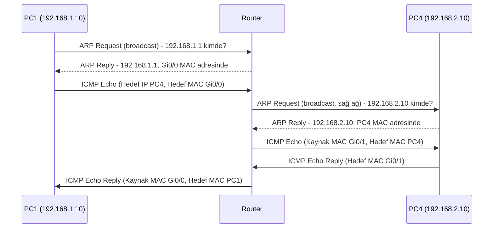

> [!summary] Özet
> Hedef başka bir ağdaysa PC, ARP ile **hedefi değil default gateway'i** sorar. Router, kendi IP'si sorulduğu için hemen cevap verir. Hedefin MAC adresini ise ancak paket kendisine ulaştığında, hedef ağa yeni bir ARP isteği göndererek öğrenir.

## Senaryo

- Bir router, iki arayüzüyle iki ayrı switch'e bağlı. Her switch'te 3 PC var.
- **Sol ağ:** `192.168.1.0/24`. Router Gi0/0 = `192.168.1.1`, PC1 = `192.168.1.10`
- **Sağ ağ:** `192.168.2.0/24`. Router Gi0/1 = `192.168.2.1`, PC4 = `192.168.2.10`
- PC1, PC4'e ping atıyor.

## Akış

## Adım adım

1. **Hedef hangi ağda?** PC1, hedef IP'yi kendi IP'si ve subnet mask'iyle karşılaştırır. `192.168.2.10` kendi ağında değil, bu yüzden paketi default gateway'e göndermesi gerekir.
2. **Gateway için ARP:** PC1'in ARP isteği "`192.168.1.1` kimde?" diye sorar. İstek broadcast olduğu için switch'teki herkese ulaşır. Diğer PC'ler sorulan IP kendilerine ait olmadığı için isteği atar. Router kendi IP'si sorulduğu için doğrudan cevap verir.
3. **Ping router'a gider:** Paketin hedef IP'si PC4, hedef MAC'i ise router'ın Gi0/0 arayüzüdür.
4. **Router karar verir:** Routing tablosunda `192.168.2.0/24`'ün Gi0/1'de doğrudan bağlı olduğunu görür. PC4'ün MAC'ini bilmediği için sağ ağa **ARP request** gönderir. Cevabı (reply) PC4 verir.
5. **Çerçeve yeniden yazılır:** Router yeni MAC başlığıyla paketi PC4'e iletir ve TTL'i 1 azaltır.
6. **Dönüş:** PC4'ün cevabı aynı yoldan geri döner. Yeni bir ARP gerekmez (aşağıya bak).

## Başlık değişimleri

|Aşama|Kaynak MAC|Hedef MAC|Kaynak IP|Hedef IP|
|---|---|---|---|---|
|PC1 → Router|PC1|Router Gi0/0|PC1|PC4|
|Router → PC4|Router Gi0/1|PC4|PC1|PC4|

> [!important] Kural
> **IP adresi nihai hedefi, MAC adresi bir sonraki durağı gösterir.** Router'dan geçerken MAC adresleri değişir, IP adresleri değişmez (NAT yoksa). TTL her router'da 1 azalır.

## Router neden öbür tarafa önceden sormuyor?

- PC1 hiçbir zaman PC4'ü sormadı, router'ın kendi IP'sini sordu. Bu soruyu cevaplamak için başka bir yere bakmaya gerek yok.
- Router hangi hedefe gideceğini ancak paket elinde olunca, IP başlığına bakarak öğrenir. Yönlendirme paket bazında yapılır.
- **ARP broadcast'leri router'dan geçmez.** Router broadcast domain'lerini ayırır. Her ağ kendi ARP çözümlemesini kendi içinde yapar.

## Dönüşte neden yeni ARP yok?

ARP isteği, gönderenin IP ve MAC bilgisini taşır. Alıcı taraf bu bilgiyi kendi ARP tablosuna kaydeder. Bu yüzden:

- **PC4**, router'ın gönderdiği ARP isteğinden router'ın Gi0/1 MAC'ini öğrenmiştir.
- **Router**, PC1'in ilk ARP isteğinden PC1'in MAC'ini öğrenmiştir.

İki tarafın da ARP tablosu dolu olduğu için cevap ek bir ARP olmadan gider.

## Packet Tracer'da kontrol

> [!tip] ARP paketinin Target IP alanına bak
> Simulation modunda PC1'in ARP paketine tıkla ve **Target IP** alanını kontrol et:
> 
> - `192.168.1.1` (gateway) yazıyorsa normal davranış budur.
> - `192.168.2.10` (PC4) yazıyorsa PC1'in **subnet mask'i yanlıştır**. PC1 hedefi kendi ağında sanıyordur ve router [[Proxy ARP]] ile onun yerine cevap veriyordur. Cisco router'larda proxy ARP varsayılan olarak açıktır.

> [!warning] İlk ping'in timeout olması
> Gerçek cihazlarda router, ARP cevabını beklerken bekleyen ilk paketi çoğu zaman düşürür. Bu yüzden ilk ping timeout olur, sonrakiler başarılı olur (Cisco çıktısında `.!!!!`). Packet Tracer'da da sık görülür.

## İlgili Notlar

- [[1-CIDR Gösterimi|CIDR Gösterimi]]: bir IP'nin hangi ağa ait olduğunu belirleyen ağ/host bit ayrımı
- [[1-Nmap – Host Keşfi|Nmap – Host Keşfi]]: ARP taraması (`-PR`) bu yüzden sadece yerel ağda çalışır
- [[2-ping & traceroute|ping & traceroute]]: TTL'in her router'da azalması ve traceroute'un bunu nasıl kullandığı
